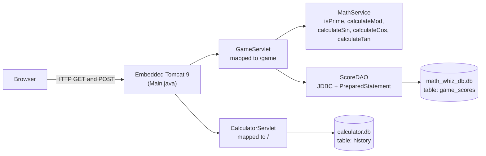
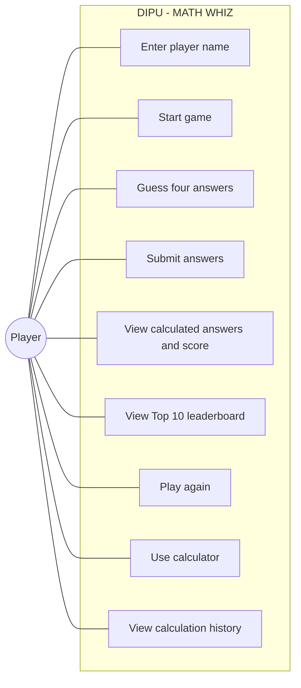
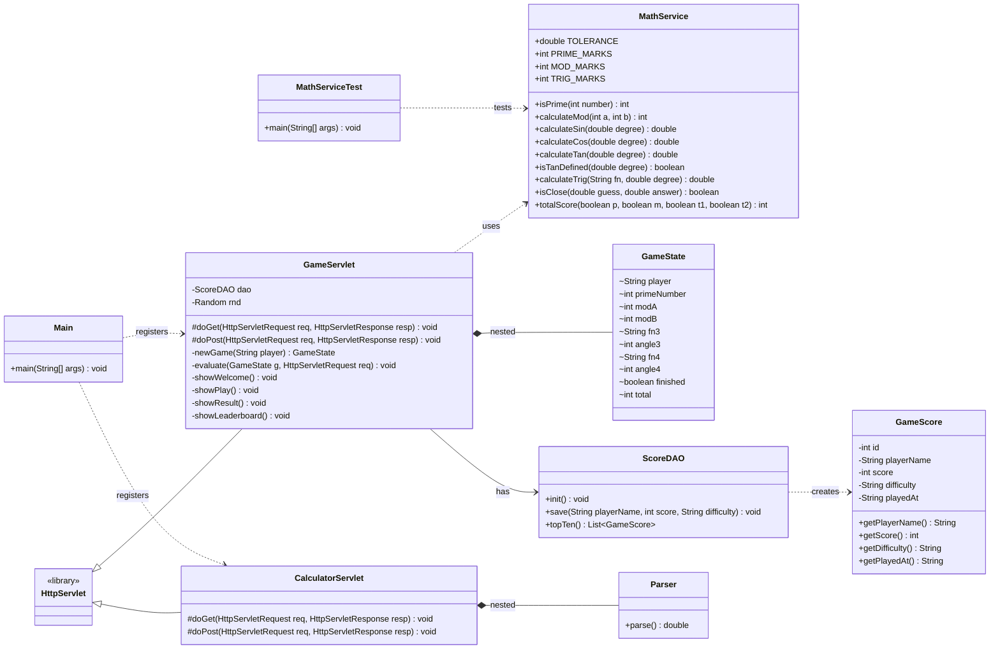
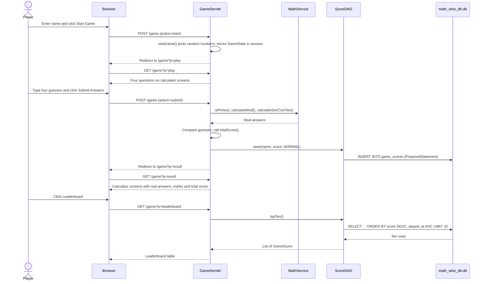
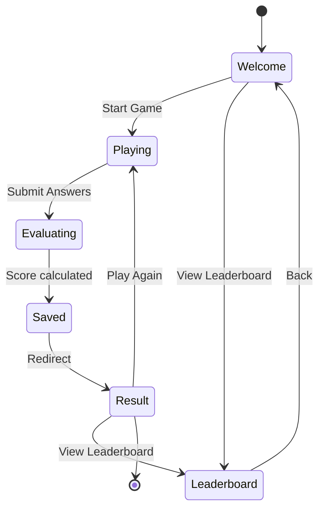
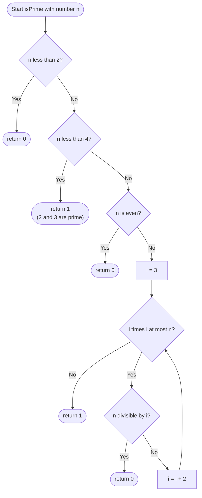
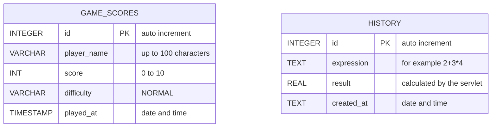

<div align="center">

# DIPU – MATH WHIZ

### A server-side mathematical game and calculator built with Java Servlets, JDBC and SQLite

**Live Lab Test #2 · Java Web Application Development**
*ICT-3107 / ICT-3108 – Software Engineering and Project Management and Lab*


-F8DC75?logo=apachetomcat&logoColor=black)


**The system gives you a number. You guess. Java calculates the truth.**

</div>

---

## Table of Contents

- [About the Project](#about-the-project)
- [Objectives](#objectives)
- [Features](#features)
- [Technologies Used](#technologies-used)
- [System Architecture](#system-architecture)
- [UML Diagrams](#uml-diagrams)
- [Mathematical Foundations](#mathematical-foundations)
- [Game Rules and Scoring](#game-rules-and-scoring)
- [Project Structure](#project-structure)
- [Database Configuration](#database-configuration)
- [Software Requirements](#software-requirements)
- [Steps to Run the Application](#steps-to-run-the-application)
- [How to Play](#how-to-play)
- [Application Routes](#application-routes)
- [Testing and Validation](#testing-and-validation)
- [Bonus Module: The Calculator](#bonus-module-the-calculator)
- [Security and Design Decisions](#security-and-design-decisions)
- [Task Checklist and Rubric Mapping](#task-checklist-and-rubric-mapping)
- [Application Screenshots](#application-screenshots)
- [Troubleshooting](#troubleshooting)
- [Future Improvements](#future-improvements)
- [GitHub Project Directory Link](#github-project-directory-link)
- [Author](#author)

---

## About the Project

**DIPU – MATH WHIZ** is a web-based mathematical *game* (not a quiz). The system generates the
numbers, the player **guesses** the answer, and then the application **calculates the real answer
by calling the matching Java method** and shows it on a calculator-style screen.

> [!IMPORTANT]
> No answer is ever stored or hard-coded. Every correct answer is produced at run time by a reusable
> Java method in `MathService`, exactly as the assignment requires.

The game covers three areas of mathematics:

| # | Area | Task | Java method |
|---|------|------|-------------|
| 1 | **Prime number** | Is the number prime? (`1` = prime, `0` = not prime) | `isPrime(int)` |
| 2 | **Modulus** | Remainder of an integer division | `calculateMod(int, int)` |
| 3 | **Trigonometry** | Sine, cosine or tangent of an angle in degrees | `calculateSin`, `calculateCos`, `calculateTan` |

Each finished game is saved to a database (player name, score, difficulty, date/time) and the
**top 10 scores** are displayed on a leaderboard.

---

## Objectives

- Develop **reusable Java methods** for prime, modulus and trigonometric calculations.
- Apply **conditional logic** and decision making to evaluate guesses and compute a score.
- Understand **Servlet request and response processing** (`GET`, `POST`, redirects, sessions).
- Implement **JDBC connectivity** with `PreparedStatement` for `INSERT` and `SELECT`.
- **Retrieve, sort and display** database records (Top 10 leaderboard).
- Document and submit a complete Java web application through **GitHub**.

---

## Features

- 🎮 Four randomly generated challenges every game: 1 prime, 1 modulus, 2 trigonometry.
- 🧮 **Calculator-style screens** show each question and, after submitting, the real answer.
- ✅ Instant marking: correct guess earns marks, wrong guess earns nothing. Maximum **10**.
- 🏆 **Top 10 leaderboard** sorted by score (high to low), then by date/time (earliest first).
- 💾 Every game saved with name, score, **difficulty (`NORMAL`)** and timestamp.
- 🔁 *Play Again* with one click.
- 🧠 Safe question generation: never a zero divisor, never an undefined tangent, never the same trig question twice.
- ➕ Bonus: a full **calculator** (`+ − × ÷ %`, brackets, keyboard support) that stores its history in SQLite.
- 🛡️ Input validation, HTML escaping and the Post/Redirect/Get pattern.
- 🧪 Plain-Java test class covering every case from the assignment's test table.

---

## Technologies Used

| Layer | Technology |
|---|---|
| Language | Java 11+ |
| Web | Java Servlet API 4.0 (`javax.servlet`) |
| Server | Apache Tomcat 9 (embedded, started from `Main.java`) |
| Database | SQLite through JDBC (`sqlite-jdbc 3.45.3.0`) |
| Build tool | Apache Maven |
| Front end | HTML5, CSS3, vanilla JavaScript (calculator keypad) |
| Diagrams | Mermaid (rendered natively by GitHub) |
| Maths notation | LaTeX (rendered natively by GitHub) |

---

## System Architecture



**Request flow in one sentence:** the browser sends a request, Tomcat hands it to the matching
servlet, the servlet uses `MathService` for calculations and `ScoreDAO` for the database, and
finally writes an HTML page back to the browser.

---

## UML Diagrams

### 1. Use Case Diagram



### 2. Class Diagram



### 3. Sequence Diagram – One Complete Game



### 4. State Diagram – Game Lifecycle



### 5. Activity Flowchart – `isPrime(int number)`



### 6. Entity-Relationship Diagram



> `GAME_SCORES` (file `math_whiz_db.db`) belongs to the game. `HISTORY` (file `calculator.db`)
> belongs to the bonus calculator. They are separate databases and are intentionally not linked.

---

## Mathematical Foundations

All formulas below are implemented in `MathService.java`.

### Prime numbers

A natural number $n$ is prime when $n \ge 2$ and it has no divisor between $2$ and $\lfloor\sqrt{n}\rfloor$:

$$
\mathrm{isPrime}(n)=
\begin{cases}
1 & \text{if } n \ge 2 \text{ and } \nexists\, d \in \{2,\dots,\lfloor\sqrt{n}\rfloor\} : d \mid n\\[4pt]
0 & \text{otherwise}
\end{cases}
$$

Only divisors up to $\sqrt{n}$ are tested, so the running time is $O(\sqrt{n})$.
In the code this is the loop condition `i * i <= number`.

### Modulus

The mathematical remainder satisfies $a = b\,q + r$. Java's `%` operator truncates the quotient
towards zero:

$$
r = a - b \cdot \operatorname{trunc}\!\left(\frac{a}{b}\right), \qquad b \ne 0
$$

| Expression | Result | Reason |
|---|---|---|
| $17 \bmod 5$ | $2$ | $17 = 5\cdot 3 + 2$ |
| $-17 \bmod 5$ | $-2$ | quotient truncates to $-3$, so $r = -17 + 15$ |
| $17 \bmod -5$ | $2$ | quotient truncates to $-3$, so $r = 17 - 15$ |
| $17 \bmod 0$ | error | `IllegalArgumentException("Divisor must not be zero")` |

### Trigonometry

Players and the code both work in **degrees**. Java's `Math` class needs **radians**, so every
angle is converted first:

$$
\theta_{\text{rad}} = \theta_{\text{deg}} \cdot \frac{\pi}{180}
$$

Then $\sin\theta$, $\cos\theta$ and $\tan\theta$ are computed with `Math.sin`, `Math.cos` and `Math.tan`.
On the unit circle a point is $(x, y) = (\cos\theta, \sin\theta)$, which gives the reference identity:

$$
x^2 + y^2 = 1 \;\Longleftrightarrow\; \sin^2\theta + \cos^2\theta = 1
$$

and the tangent is

$$
\tan\theta = \frac{\sin\theta}{\cos\theta}
$$

which is **undefined** whenever $\cos\theta = 0$, that is

$$
\theta \equiv 90^\circ \pmod{180^\circ}
$$

`calculateTan` throws an `ArithmeticException` at those angles, and the game never asks for them.

**Exact values used as a sanity check**

| $\theta$ | $\sin\theta$ | $\cos\theta$ | $\tan\theta$ |
|:---:|:---:|:---:|:---:|
| $0^\circ$ | $0$ | $1$ | $0$ |
| $30^\circ$ | $\frac{1}{2}$ | $\frac{\sqrt{3}}{2}$ | $\frac{\sqrt{3}}{3}$ |
| $45^\circ$ | $\frac{\sqrt{2}}{2}$ | $\frac{\sqrt{2}}{2}$ | $1$ |
| $60^\circ$ | $\frac{\sqrt{3}}{2}$ | $\frac{1}{2}$ | $\sqrt{3}$ |
| $90^\circ$ | $1$ | $0$ | undefined |

### Comparing decimal answers

Computers store decimals approximately (for example $\tan 45^\circ$ is `1.0000000000000002`), and
players type rounded numbers. A guess $g$ is therefore accepted when it is close enough to the
real answer $a$:

$$
|g - a| \le \varepsilon, \qquad \varepsilon = 0.01
$$

### Score

With marks $m = (2, 2, 3, 3)$ and a correctness indicator $c_i \in \{0, 1\}$ for each question:

$$
S = \sum_{i=1}^{4} m_i \, c_i = 2c_1 + 2c_2 + 3c_3 + 3c_4, \qquad 0 \le S \le 10
$$

---

## Game Rules and Scoring

**Difficulty:** `NORMAL` – all questions currently share one difficulty level. The value is still
stored in the database with every score so that more levels can be added later.

| Question | Mathematical area | What the system gives | What you guess | Marks |
|---|---|---|---|:---:|
| Q1 | Prime number | an integer from 1 to 100 | `1` (prime) or `0` (not prime) | 2 |
| Q2 | Modulus (integers only) | `a % b`, with `b` from 2 to 12 | the remainder | 2 |
| Q3 | Trigonometry (sin or cos) | an angle in degrees | the value, 2 decimals | 3 |
| Q4 | Trigonometry (sin, cos or tan) | an angle in degrees | the value, 2 decimals | 3 |
| | | | **Total** | **10** |

**Rules**

1. Prime: `isPrime` returns `1` for a prime and `0` otherwise. Numbers below 2 are not prime.
2. Modulus: integer operands only. The divisor can never be zero.
3. Trigonometry: angles are in degrees and converted to radians before calculating.
4. Decimal guesses are accepted within $\pm 0.01$ of the real answer.
5. A wrong (or empty or invalid) guess earns **0** marks for that question.
6. The leaderboard sorts by score (high to low), then by date/time (earliest first) for equal scores.

```java
int totalScore = 0;

if (primeCorrect) totalScore += 2;
if (modCorrect)   totalScore += 2;
if (trig1Correct) totalScore += 3;
if (trig2Correct) totalScore += 3;
```

---

## Project Structure

> The project root is the folder `LIve Lab Test # 2`.

```
LIve Lab Test # 2/
├── pom.xml                              Maven build file (dependencies)
├── README.md                            this file
├── .gitignore
├── database/
│   └── math_whiz_db.sql                 database creation SQL
├── screenshots/                         application screenshots (used by this README)
└── src/main/java/calc/
    ├── Main.java                        starts embedded Tomcat, registers both servlets
    ├── GameServlet.java                 controller: welcome, game, result, leaderboard
    ├── MathService.java                 service: isPrime, calculateMod, trig methods, scoring
    ├── ScoreDAO.java                    DAO: JDBC code for the game_scores table
    ├── GameScore.java                   model: one row of game_scores
    ├── MathServiceTest.java             tests for every assignment test case
    └── CalculatorServlet.java           bonus: calculator + history table
```

The code follows the layered idea suggested in the assignment (controller → service → DAO → model),
kept in a single package so that a beginner can read it easily.

| Layer | Class | Responsibility |
|---|---|---|
| Controller | `GameServlet` | reads requests, runs the game, chooses the page to show |
| Service | `MathService` | all mathematical logic and scoring |
| DAO | `ScoreDAO` | all SQL and JDBC code |
| Model | `GameScore` | data for one leaderboard row |

---

## Database Configuration

The project uses **SQLite**, so there is no database server, user name or password to configure.
The database **`math_whiz_db`** is the file `math_whiz_db.db`, which is created automatically in the
project folder the first time the application starts. The JDBC URL is built in `ScoreDAO.java`:

```java
jdbc:sqlite:<project folder>/math_whiz_db.db
```

### Database creation SQL

Also available in [`database/math_whiz_db.sql`](database/math_whiz_db.sql).

```sql
CREATE TABLE IF NOT EXISTS game_scores (
    id          INTEGER PRIMARY KEY AUTOINCREMENT,
    player_name VARCHAR(100) NOT NULL,
    score       INT          NOT NULL,
    difficulty  VARCHAR(20)  NOT NULL,
    played_at   TIMESTAMP    NOT NULL
);
```

| Field | Data type | Notes |
|---|---|---|
| `id` | INTEGER, primary key, auto increment | unique row number |
| `player_name` | VARCHAR(100) | name typed by the player |
| `score` | INT | 0 to 10 |
| `difficulty` | VARCHAR(20) | always `NORMAL` for now |
| `played_at` | TIMESTAMP | local date and time of the game |

**Save a game** (executed with a `PreparedStatement`):

```sql
INSERT INTO game_scores (player_name, score, difficulty, played_at)
VALUES (?, ?, ?, datetime('now', 'localtime'));
```

**Top 10 leaderboard:**

```sql
SELECT id, player_name, score, difficulty, played_at
FROM game_scores
ORDER BY score DESC, played_at ASC
LIMIT 10;
```

### Viewing the database

- **IntelliJ IDEA Ultimate:** Database tool window → `+` → Data Source → SQLite → choose `math_whiz_db.db`.
- **Any edition:** open the file with the free [DB Browser for SQLite](https://sqlitebrowser.org/).
- **Inside the app:** the leaderboard page shows the same data.

---

## Software Requirements

| Software | Version | Notes |
|---|---|---|
| JDK | 11 or newer | tested with modern JDKs |
| Maven | 3.6+ | built into IntelliJ IDEA |
| IDE (optional) | IntelliJ IDEA / Eclipse / VS Code | any IDE that imports Maven projects |
| Web browser | any modern browser | Chrome, Edge, Firefox |
| Internet | first run only | Maven downloads the libraries |

Tomcat does **not** need to be installed. It is included as a library and started by `Main.java`.

---

## Steps to Run the Application

### 1. Get the code

```bash
git clone https://github.com/Dipu22222/Software-Engineering-and-Project-Management-and-Lab---ICT-3107-ICT-3108-.git
cd "Software-Engineering-and-Project-Management-and-Lab---ICT-3107-ICT-3108-/LIve Lab Test # 2"
```

### 2a. Run with IntelliJ IDEA (easiest)

1. **File → Open** and select the `LIve Lab Test # 2` folder (the one containing `pom.xml`).
2. Wait until Maven finishes importing.
3. Open `src/main/java/calc/Main.java` and click the green ▶ next to `main`.
4. Wait for the console to print the addresses.

### 2b. Run from a terminal

```bash
mvn compile exec:java
```

To use another port: `mvn compile exec:java -Dexec.args="9090"`

### 3. Open in the browser

| Page | Address |
|---|---|
| Game | http://localhost:8080/game |
| Leaderboard | http://localhost:8080/game?p=leaderboard |
| Calculator | http://localhost:8080/ |

Stop the server with the red ■ button in IntelliJ, or `Ctrl + C` in the terminal.

---

## How to Play

1. Open **http://localhost:8080/game**, type your name and click **Start Game**.
2. Read the four calculator screens. Each shows a question such as `isPrime(27) = ?`, `66 % 3 = ?` or `cos(330°) = ?`.
3. Type your **guess** under each screen.
   - Prime question: type `1` for prime or `0` for not prime.
   - Modulus question: type the remainder as a whole number.
   - Trigonometry questions: type the value with 2 decimals, for example `0.87`.
4. Click **Submit Answers**.
5. The result page shows the **real answer calculated by Java** on each calculator screen, whether your guess was correct, the marks earned and your total out of 10.
6. Click **Leaderboard** to see the top 10, or **Play Again** to try new numbers.

---

## Application Routes

| Method | URL | Parameters | What it does |
|---|---|---|---|
| GET | `/game` | – | Welcome page (Screen 1) |
| POST | `/game` | `action=start`, `player` | Creates a new game and redirects to the questions |
| GET | `/game?p=play` | – | Game page with four questions (Screen 2) |
| POST | `/game` | `action=submit`, `q1`…`q4` | Calculates answers, scores, saves to the database |
| GET | `/game?p=result` | – | Result page (Screen 3) |
| GET | `/game?p=leaderboard` | – | Top 10 leaderboard (Screen 4) |
| GET | `/` | – | Calculator page |
| POST | `/` | `expr` | Calculates and saves an expression |
| POST | `/` | `action=clear` | Clears the calculator history |

---

## Testing and Validation

Run the `main` method of `MathServiceTest` in your IDE, or use:

```bash
mvn compile exec:java -Dexec.mainClass=calc.MathServiceTest
```

| Test case | Expected result | Status |
|---|---|:---:|
| Prime input: 7 | `1` | ✅ |
| Prime input: 8 | `0` | ✅ |
| Prime input: 1 | `0` | ✅ |
| Modulus: 17 % 5 | `2` | ✅ |
| Sine: 30° | `0.5` | ✅ |
| Cosine: 60° | `0.5` | ✅ |
| Tangent: 45° | `1.0` | ✅ |
| Divisor: 0 | Validation error | ✅ |
| All answers correct | Maximum 10 marks | ✅ |
| Incorrect answers | Corresponding marks not awarded | ✅ |

**Extra cases covered:** `isPrime(0)`, `isPrime(-5)`, `isPrime(2)`, `isPrime(97)`, `isPrime(100)`,
`-17 % 5 = -2`, `17 % -5 = 2`, `0 % 5 = 0`, `tan(90°)` is undefined, only-prime-correct scores 2,
only-trigonometry-correct scores 6, all wrong scores 0.

**Expected console output**

```
PASS  isPrime(7) = 1
PASS  isPrime(8) = 0
...
All tests passed.
```

**Game simulation:** 5,000 generated games were checked automatically. A player who always
answered correctly scored 10 every time, a player who always answered wrongly scored 0 every time,
and no game contained an undefined tangent, a zero divisor or a repeated trigonometry question.
The prime question was a prime in about 50% of the games.

---

## Bonus Module: The Calculator

Besides the game, the project contains a working **calculator** at `/` with the same dark
calculator design.

- Keypad: `C`, `⌫`, `%`, `÷`, `×`, `−`, `+`, digits and `.`; keyboard input also works.
- The expression is sent to `CalculatorServlet`, which evaluates it **on the server** with a small
  recursive-descent parser, so `12+5×3` correctly gives `27`.
- Every calculation is saved in the `history` table of `calculator.db` and shown under the calculator.

Grammar used by the parser (EBNF):

```
expr   = term   { ( "+" | "-" ) term } ;
term   = factor { ( "*" | "/" | "%" ) factor } ;
factor = number | "(" expr ")" | "-" factor | "+" factor ;
```

Because `expr` asks `term` for its operands, multiplication, division and modulus are always
evaluated before addition and subtraction.

---

## Security and Design Decisions

| Decision | Why |
|---|---|
| `PreparedStatement` for every query with user data | prevents SQL injection |
| HTML escaping (`esc()`) of every value written to a page | prevents cross-site scripting (a player named `<b>` is shown as text) |
| Post/Redirect/Get after submitting | refreshing the result page cannot save a score twice |
| Game state (the random numbers) kept in the server-side **session** | the player cannot change the questions, and answers are always recalculated on the server |
| Answers calculated, never stored | required by the assignment and keeps `MathService` reusable |
| Tolerance $\varepsilon = 0.01$ for decimals | avoids false "wrong" results caused by rounding |
| Validation of names, numbers and divisor | empty or invalid input is handled without crashing |
| `difficulty` column stored although only `NORMAL` exists | ready for future difficulty levels |

---

## Task Checklist and Rubric Mapping

| Task | Description | Where it is implemented | Done |
|---|---|---|:---:|
| 01 | Project setup | `pom.xml`, `Main.java` (embedded Tomcat), JDBC driver | ✅ |
| 02 | Game interface | `GameServlet` pages: welcome, game, result, leaderboard | ✅ |
| 03 | Prime number function | `MathService.isPrime(int)` | ✅ |
| 04 | Modulus function | `MathService.calculateMod(int, int)` | ✅ |
| 05 | Trigonometric functions | `calculateSin`, `calculateCos`, `calculateTan` | ✅ |
| 06 | Game logic | `GameServlet.newGame()`, `evaluate()`, `MathService.totalScore()` | ✅ |
| 07 | Database design with JDBC | `ScoreDAO`, table `game_scores`, `PreparedStatement` | ✅ |
| 08 | Top 10 leaderboard | `ScoreDAO.topTen()`, `showLeaderboard()` | ✅ |
| 09 | Testing and validation | `MathServiceTest.java` | ✅ |
| 10 | Documentation and GitHub | this `README.md`, `database/math_whiz_db.sql`, screenshots | ✅ |

| Assessment criterion | Marks | Evidence |
|---|:---:|---|
| Project setup and interface | 1 | `pom.xml`, `Main.java`, four game screens |
| Prime number function | 1 | `isPrime` + tests |
| Modulus function | 1 | `calculateMod` + tests |
| Trigonometric functions | 2 | `calculateSin/Cos/Tan` + tests |
| Game logic and score calculation | 1 | `evaluate()`, `totalScore()` |
| JDBC and database operations | 2 | `ScoreDAO` (`INSERT`, `SELECT`, `PreparedStatement`) |
| Top 10 leaderboard | 1 | `topTen()` with `ORDER BY score DESC, played_at ASC LIMIT 10` |
| README and screenshots | 1 | this file and the `screenshots` folder |
| **Total** | **10** | |

---

## Application Screenshots

### Screenshot 1


### Screenshot 2


---

## Troubleshooting

| Problem | Solution |
|---|---|
| `Port 8080 already in use` | Stop the old run (red ■) or start on another port: `mvn compile exec:java -Dexec.args="9090"` |
| Maven cannot download libraries | Check the internet connection, then click the Maven **Reload** button |
| Browser shows 404 | Make sure `Main` is running and the address is `http://localhost:8080/game` |
| `math_whiz_db.db` not visible in the project | Play one game, then right-click the project folder → **Reload from Disk** |
| Database tool shows no driver | Click **Download missing driver files** in IntelliJ |
| "Unsupported class version" error | Use JDK 11 or newer |

---

## Future Improvements

- Additional difficulty levels (`EASY`, `HARD`) with different number ranges.
- A timer and bonus points for fast answers.
- Player accounts and a personal score history.
- A JSP or Spring Boot version of the interface.
- Switching the database to MySQL (the SQL for it is included as a comment in `database/math_whiz_db.sql`).

---

## GitHub Project Directory Link

**Subdirectory link (submission format):**

https://github.com/Dipu22222/Software-Engineering-and-Project-Management-and-Lab---ICT-3107-ICT-3108-/tree/main/LIve%20Lab%20Test%20%23%202

---

## Author

**Dipu** – GitHub: [@Dipu22222](https://github.com/Dipu22222)

Course: *Software Engineering and Project Management and Lab (ICT-3107 / ICT-3108)* –
Live Lab Test #2: Java Servlet and JDBC.

<div align="center">

*Guess. Calculate. Score. Repeat.*

</div>
